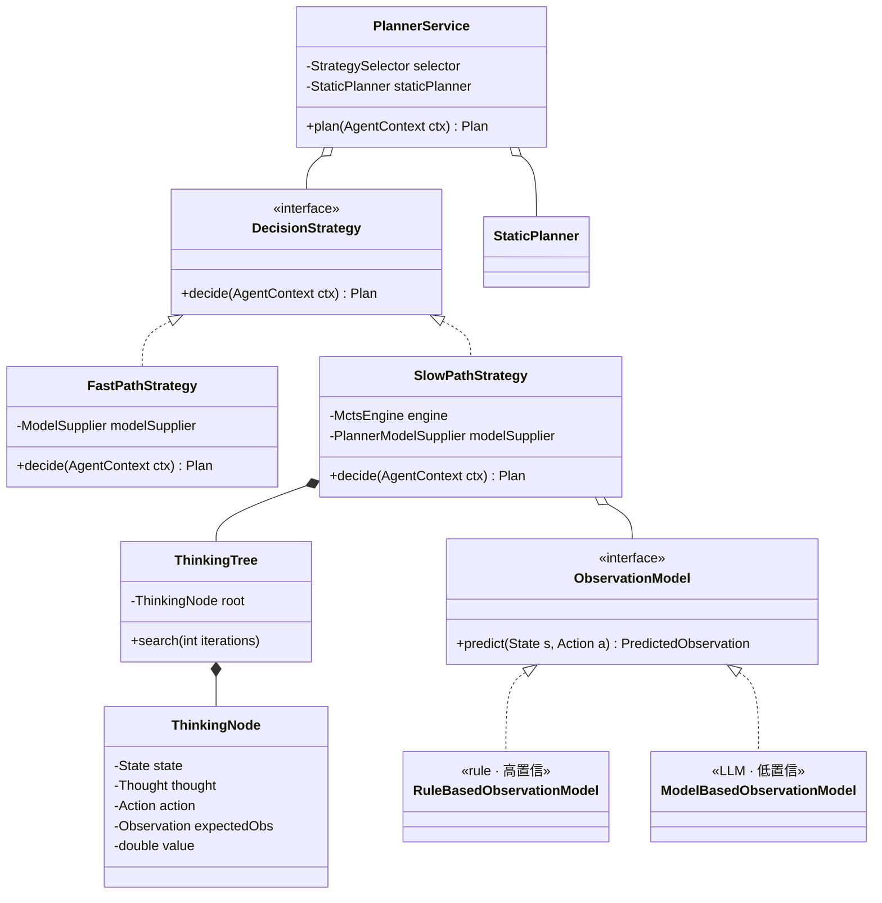
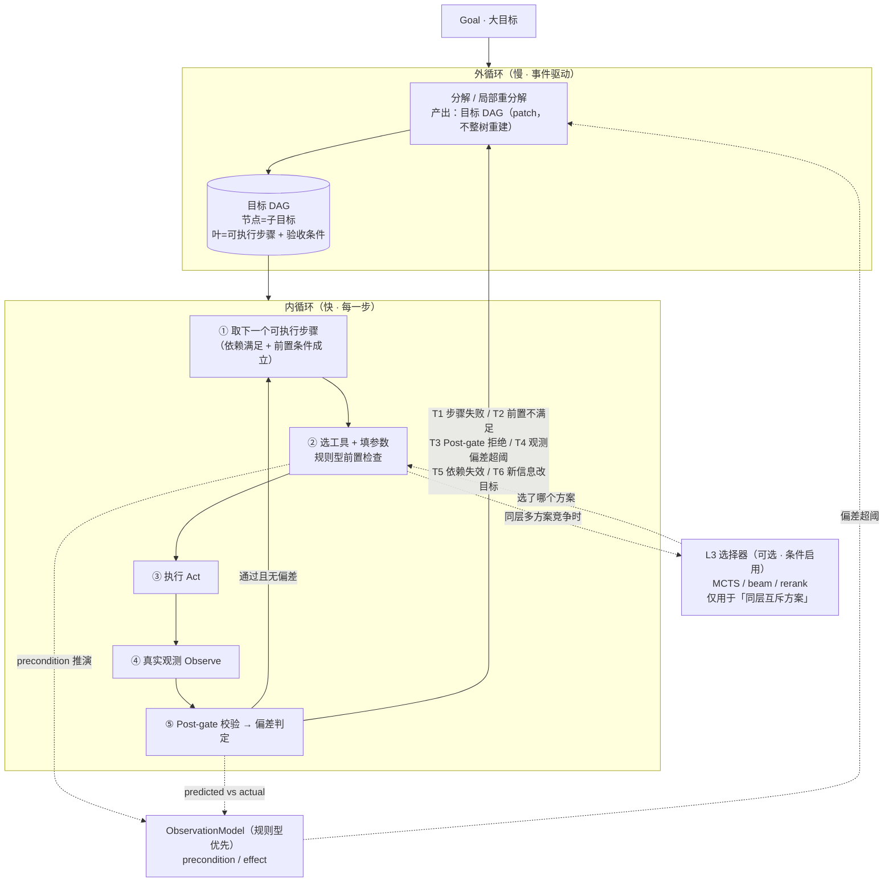

# alice-core-planner 设计

> **2026-10-24 设计修正（原 `WorldModel` 弃用，能力保留）**
>
> **弃用的是两件事**：① 把"预测观测"做成一个名叫 `WorldModel` 的**单一万能组件**；② 让它在**规划期承担"验证"职责**。
>
> **保留并重做的是"预测观测"本身**——MCTS 展开时需要知道"这个动作大概会得到什么观测"，否则无法给路径打分。
> 它的实现天然分两类，**置信度不同、用途不同，不能同型混用**：
>
> | 实现 | 形态 | 可信度 | 允许的用途 |
> |---|---|---|---|
> | **规则型** `RuleBasedObservationModel` | 工具语义 / 文件系统 / DB schema / SOP 约束 | **高**（可判、可写反例） | 参与评分；**可参与前置拒绝**（如越权路径必失败） |
> | **模型型** `ModelBasedObservationModel` | LLM / 统计预测 | **低**（会幻觉） | **只参与路径排序/评分**；**禁止作为放行依据** |
>
> **三条硬约束**：
> 1. 预测观测必须带 `confidence: rule \| model` 与来源，**不得与真实观测同型混用**（否则下游分不清"预测"与"事实"）；
> 2. **验证只发生在执行后**（真实观测 → `Post-gate`）；预测观测**不构成证据**；
> 3. 真实观测回传后做 **predicted vs actual 偏差比对**，用于校准/降权该预测实现——这才是"验证"的合法形式：**验证模型，而不是用模型验证世界**。
>
> 附带事实：仓内从未有 `WorldModel.java`（`SlowPathStrategy` 实际依赖 `MctsEngine` + `PlannerModelSupplier`）。

针对 **alice-core-planner** 的设计，核心挑战在于如何将"双路径决策"与 Java 的工程性（强类型、多线程、内存管理）深度结合。这个模块不只是调用 LLM，而是一个**状态化的推理机**。

以下是 alice-core-planner 的深度模块化设计：

---

## **1. 模块类图 (Core Planner Classes)**

设计采用了 **策略模式 (Strategy Pattern)** 来实现双路径决策，并利用 **状态模式 (State Pattern)** 管理思维树。




---

## **2. 双循环决策逻辑流（内循环每步 / 外循环事件驱动）**

> **决策依据**：`docs/architecture/adr/ADR-0001-规划为执行流内的双循环.md`（2026-10-24）。
> **原"双路径（Fast/Slow）"表述作废**：快/慢不是"入口按 prompt 长度二选一"，而是**执行流内两个不同粒度的决策点**。



> **三层定位（不要混）**：
> - **L1 分解器**（必须有）：大目标 → 子目标 DAG；评"可执行 / 无环 / 有验收条件"，**不用搜索**；
> - **L2 可判评估**（必须有）：`precondition / effect` 规则推演，判"能不能执行""偏差有没有发生"；
> - **L3 选择器**（可选）：仅当同层存在多个互斥方案且方案本身是一串步骤时启用（MCTS 在此才有意义）。
>
> **硬约束**：无廉价转移模型 / 无收益定义 ⇒ **禁止启用 L3**（fail-closed，且不得输出 `bestAction/bestAvgReward` 当作结论）。

## **3. 核心设计细节 (Engineering Implementation)**

### **3.1 静态规划 (Static Planning) 与 Procedural Memory**
对于 SOP 明确的任务，我们引入 `SopRegistry`。它不仅是字符串匹配，而是利用 **Semantic Router**。
* **实现建议**：使用 `alice-memory-vault` 中的向量索引检索最匹配的流程模板（JSON/YAML）。
* **Java 实现**：`StaticPlanner` 负责将模板直接解析为一系列 `Action` 列表，完全跳过模型生成，保证确定性。

### **3.2 动态规划：MCTS 推理树 (Slow Path)**
在 Java 内存中维护 `ThinkingTree`。每个 `ThinkingNode` 包含：
* **State (S)**：当前的 AgentContext 快照。
* **Action (A)**：规划执行的操作。
* **Value (V)**：由 `ObservationModel` 的**预测观测** + 启发式给出的路径得分——**是评分，不是验证结论**；规则型预测可参与前置拒绝，模型型只能排序（真实验证在 `Post-gate`）。
* **工程考量**：利用 `java.util.concurrent.ForkJoinPool` 并行评估多个推理分支，加快 MCTS 的模拟（Simulation）阶段。

### **3.3 模型抽象层 (Model Supplier API)**
为了实现 **LLM Agnostic**，Planner 并不直接持有 OpenAI 或 Ollama 的客户端，而是持有 `ModelCapabilities`：
```java
public interface ModelSupplier {
    // 高性能模型用于复杂推理 (System 2)
    ModelSession getReasoningModel();
    // 轻量模型用于快速分类或简单指令 (System 1)
    ModelSession getInstructionModel();
}
```

---

## **4. 执行流状态机 (ASCII Text)**

> 说明：本图对应 ADR-0001 的双循环——**没有"入口选快慢"这一步**；外循环只在 §2 的六个信号出现时被唤醒。

描述 Planner 内部从"接收意图"到"交付路径"的过程：

```text
       [ RECEIVE CONTEXT ]
               |
               v
      /-----------------\
     |  STRATEGY ROUTER  |
      \-------+---------/
              |
      +-------+-------+
      |               |
[ FAST PATH ]   [ SLOW PATH ]
      |               |
      |        (TREE EXPANSION) <-----+
      |               |               |
      |     (ROLLOUT / 价值回传) ------+
      |     ※ 这里只评分，不验证
      |               |
      +-------+-------+
              |
              v
      [ PLAN REFINEMENT ]
              |
      [ EMIT NEXT STEP ]  ──> 执行后：真实观测 ⇒ Post-gate 校验（唯一验证点）
                              通过 ⇒ 采纳 / 不通过 ⇒ 局部重规划
```

---

## **5. 针对 alice-core-planner 的后续开发建议**

* **Token 熔断机制**：在 Slow Path 的 MCTS 搜索中，必须设置 `TokenBudget`。当搜索深度或消耗超过阈值时，强制回退到当前最优分支。
* **序列化能力**：`ThinkingTree` 应该支持序列化到 `alice-memory-vault`。这样当用户中途打断对话时，Agent 在下次唤醒后可以从上次的"思维断点"继续搜索，而不是重新开始。
* **多模型混部方案**：
    * **Router**: 使用轻量化的模型（如 Qwen-1.8B 或 Llama-3-8B）做复杂度判定。
    * **Slow Path**: 使用 DeepSeek-V3 或 GPT-4o 做 MCTS 的 Node 节点生成。
    * **Fast Path**: 直接透传。

这个设计目标将 Planner 从一个简单的"提示词包装器"提升为了一个真正的**具有元认知能力（Metacognition）**的工程模块。