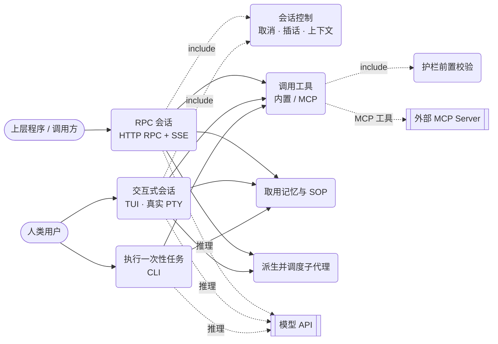
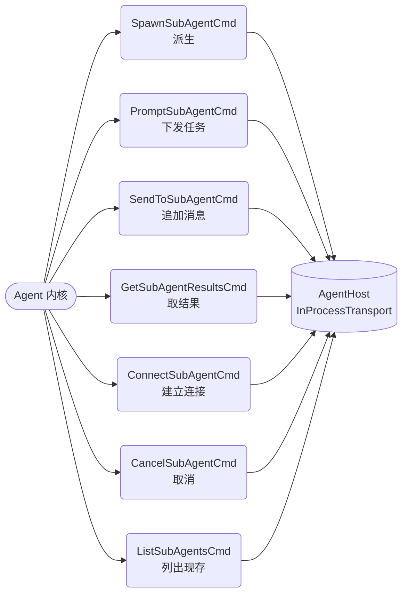

# alice-agent 用例图

> **证据来源**：`docs/功能说明书.md` §3（三条真实使用路径，实跑验证）· `alice-agent-proto` 的 13 个命令类 · `alice-agent-runtime` 的 `AgentEngine` 方法面。
> **口径**：只收**有文档或代码背书**的用例；不写路线图里"计划中"的能力。Mermaid 无原生 UML 用例图，本文用 `flowchart` 近似（圆角=用例，胶囊=参与者）。

## 1. 参与者与主用例

> 中间三列（三条路径 → 能力用例 → 外部系统）都在 **alice-agent 系统边界**内；外部只有模型 API 与 MCP Server。虚线 = `include` 或外部依赖。

## 2. 子代理族的用例（按 proto 命令类映射）

proto 里 7 个子代理命令 ⇒ 7 个用例，**这是"多 agent 协作"在 alice-agent 里的真实落点**：

## 3. 未收进来的（有理由）

| 事项 | 为什么不在图里 |
|---|---|
| SRE/运维视角用例（健康检查、指标） | 只有 `HostHealth`/`Metrics` 类，**没有文档化的使用路径**，不构成用例 |
| "自动编排多 agent 完成复杂任务" | 命令类支持派生/调度，但**没有端到端实跑的路径文档** ⇒ 愿望，不是用例 |
| Web/TUI 之外的图形前端 | 不存在 |
